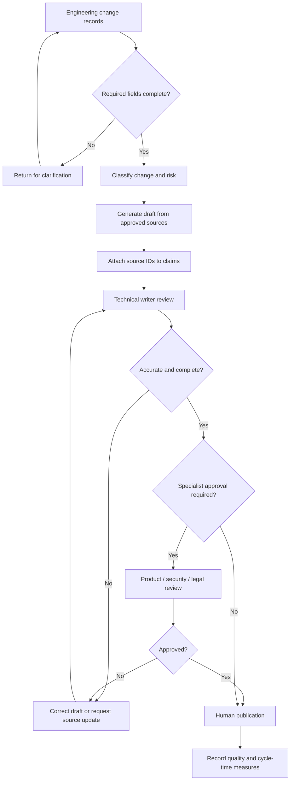

# 1. Workflow overview

## Objective

Create a repeatable, auditable process for drafting release notes from engineering change records while reducing repetitive first-draft effort. The process is designed to improve consistency, not to delegate editorial accountability to a model.

## Users and responsibilities

| Role | Responsibility |
|---|---|
| Product/engineering contributor | Supplies accurate, complete change records and confirms technical facts |
| AI assistant | Produces a structured draft only from supplied source material; flags gaps |
| Technical writer | Curates inputs, reviews every claim, edits for audience and style |
| Product owner | Confirms feature behavior, availability, prerequisites, and customer impact |
| Security/legal/compliance reviewer | Reviews changes that trigger specialist approval |
| Publisher | Publishes only the approved version |

## Workflow

1. **Intake:** Collect change records using the defined data contract.
2. **Triage:** Classify each change as customer-facing, internal-only, or requiring specialist review.
3. **Preflight:** Reject incomplete records or mark missing fields for confirmation.
4. **Draft:** Generate release-note candidates using the controlled prompt.
5. **Trace:** Associate each sentence or bullet with one or more source IDs.
6. **Editorial QA:** Check facts, completeness, terminology, style, accessibility, and risk.
7. **Approval:** Obtain product-owner and any required specialist approval.
8. **Publish:** A human publisher moves the approved content to the release channel.
9. **Measure:** Record time, correction categories, omissions, and approval outcomes.

## Process flow

## Inputs and outputs

**Inputs**
- Approved change records.
- Product terminology and style guide.
- Release scope and audience.
- Known limitations and rollout information.
- Explicit exclusions (for example, internal-only changes).

**Outputs**
- Draft release notes.
- Claim-to-source traceability.
- Open questions and missing-information list.
- QA record and approval status.
- Published release notes after human approval.

## Non-goals

- Generating undocumented product behavior.
- Replacing engineering or product-owner verification.
- Automatically publishing model output.
- Making legal, security, regulatory, or contractual determinations.
- Using customer data or production secrets in prompts.

## Operational principle

The AI assistant is a drafting aid. It is not a source of truth. The source records and accountable reviewers remain authoritative.
